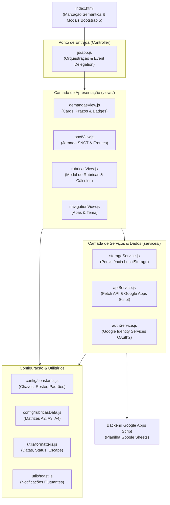

# Arquitetura Modular do Frontend — ProgWeb 2 (IFSC Garopaba)

> **Documento de Referência Arquitetural**  
> **Unidade Curricular:** Programação para a Internet 2 (CST em Sistemas para a Internet)  
> **Data de Homologação:** 02 de novembro de 2026  
> **Padrão Arquitetural:** ES6 Modules (`import` / `export`) com Separação Estrita em Camadas  

---

## 1. Contexto e Motivação da Refatoração

Durante o primeiro ciclo de desenvolvimento da disciplina, o arquivo [`index.html`](file:///Users/chameoandre/Google-Drive-chameoandre/INSTITUTO-FEDERAL-SANTA-CATARINA/CURSOS/SUPERIOR/sistemas-para-internet/unidades-curriculares/uc-programacao-para-a-internet-2/index.html) concentrava toda a marcação da aplicação e mais de **5.445 linhas de JavaScript inline** em um único bloco `<script>`.

Esse formato monolítico gerava gargalos operacionais e pedagógicos:
1. **Sobrecarga de Contexto e Lentidão:** Qualquer alteração na Central de Demandas ou na Jornada da SNCT exigia analisar e recompilar um arquivo de mais de 11.000 linhas.
2. **Alto Acoplamento:** Constantes estáticas, persistência no `localStorage`, chamadas ao Google Apps Script, Google Identity Services (OAuth2) e manipulação do DOM residiam no mesmo escopo compartilhado.
3. **Incongruência Didática:** Em sala de aula (especialmente no **Roteiro 04 — *Arquitetura Modular com ES6 Modules***), ensina-se aos estudantes a divisão do código em três camadas fundamentais (`services/`, `views/` e `utils/`). O portal da UC precisava refletir exatamente as boas práticas lecionadas.

A refatoração modular dividiu o código em responsabilidades isoladas, reduzindo o [`index.html`](file:///Users/chameoandre/Google-Drive-chameoandre/INSTITUTO-FEDERAL-SANTA-CATARINA/CURSOS/SUPERIOR/sistemas-para-internet/unidades-curriculares/uc-programacao-para-a-internet-2/index.html) em **~5.450 linhas (corte de ~50%)** e distribuindo a lógica em **módulos coesos e reutilizáveis**.

---

## 2. Visão Geral da Arquitetura em Camadas

A arquitetura adota o modelo de camadas desacopladas, onde a dependência flui da apresentação para os serviços e utilitários:



---

## 3. Estrutura de Diretórios e Arquivos

```
uc-programacao-para-a-internet-2/
├── index.html                    # Interface do Dashboard (sem scripts inline)
├── progweb2-config.js            # Configurações de ambiente (URLs e Client ID)
└── js/
    ├── app.js                    # Ponto de entrada modular (<script type="module" src="js/app.js">)
    ├── main.js                   # Módulo de exportação de contratos
    │
    ├── config/                   # Configurações e estruturas de dados estáticos
    │   ├── constants.js          # Chaves de armazenamento, roster de 24 alunos, frentes da SNCT
    │   └── rubricasData.js       # Matrizes contextuais de rubricas formativas (A2, A3 e A4)
    │
    ├── services/                 # Regras de negócio, I/O externo e persistência
    │   ├── apiService.js         # Cliente HTTP unificado para o Google Apps Script
    │   ├── authService.js        # Autenticação Google OAuth2 & vinculação de sessão
    │   └── storageService.js     # Leitura, gravação e recuperação no localStorage
    │
    ├── utils/                    # Funções puras e utilitários
    │   ├── formatters.js         # escapeHtml, formatarData e cálculo temporal de prazos
    │   └── toast.js              # Notificações visuais flutuantes (Bootstrap Toast)
    │
    └── views/                    # Renderização do DOM e controle de componentes de tela
        ├── demandasView.js       # Central de demandas, metadados visuais e contadores
        ├── navigationView.js     # Chaveamento de abas, tema claro/escuro e destaque de cards
        ├── rubricasView.js       # Modal de avaliação por rubricas e gerador de devolutivas
        └── snctView.js           # Diagrama das 5 etapas da SNCT e quadro de vagas das frentes
```

---

## 4. Detalhamento dos Módulos

### 4.1 Camada de Configuração (`js/config/`)

* **[`constants.js`](file:///Users/chameoandre/Google-Drive-chameoandre/INSTITUTO-FEDERAL-SANTA-CATARINA/CURSOS/SUPERIOR/sistemas-para-internet/unidades-curriculares/uc-programacao-para-a-internet-2/js/config/constants.js):**
  * Centraliza chaves de `localStorage` (`STORAGE_KEY_DEMANDAS`, `STORAGE_KEY_ALUNOS`, `STORAGE_KEY_GOOGLE_SESSION`, etc.).
  * Contém o roster oficial dos **24 estudantes matriculados** na UC com matrícula e e-mail (`ESTUDANTES_PADRAO`).
  * Armazena as frentes oficiais da SNCT (`DEMANDAS_PADRAO_SNCT`) e as equipes consolidadas (`EQUIPES_PROGWEB2`).
* **[`rubricasData.js`](file:///Users/chameoandre/Google-Drive-chameoandre/INSTITUTO-FEDERAL-SANTA-CATARINA/CURSOS/SUPERIOR/sistemas-para-internet/unidades-curriculares/uc-programacao-para-a-internet-2/js/config/rubricasData.js):**
  * Define as três matrizes de avaliação formativa contextual da UC:
    * `A2_SNCT`: Planejamento instrucional, rigor técnico da frente, estruturação na sala do Moodle e trabalho em equipe.
    * `A3_PROJETO`: Backend REST com Flask/SQLite, Frontend Fetch API, contingência offline e usabilidade.
    * `A4_ROTEIROS`: JavaScript modular ES6, manipulação do DOM e formulários, consumo assíncrono e responsividade.
  * Fornece as funções resolvedoras `obterModeloRubricaParaDemanda(demandaId)` e `obterDimensoesRubricaParaDemanda(demandaId)`.

---

### 4.2 Camada de Utilitários (`js/utils/`)

* **[`formatters.js`](file:///Users/chameoandre/Google-Drive-chameoandre/INSTITUTO-FEDERAL-SANTA-CATARINA/CURSOS/SUPERIOR/sistemas-para-internet/unidades-curriculares/uc-programacao-para-a-internet-2/js/utils/formatters.js):**
  * `escapeHtml(str)`: Sanitização estrita contra ataques de Cross-Site Scripting (XSS).
  * `formatarData(dataStr)`: Conversão de datas ISO (`AAAA-MM-DD`) para o formato brasileiro (`DD/MM/AAAA`).
  * `calcularStatusPrazo(prazoStr, concluida, horaPrazo)`: Retorna classe visual e texto indicativo (*Concluída*, *Entrega Hoje!*, *Faltam n dias*, *Prazo encerrado*).
* **[`toast.js`](file:///Users/chameoandre/Google-Drive-chameoandre/INSTITUTO-FEDERAL-SANTA-CATARINA/CURSOS/SUPERIOR/sistemas-para-internet/unidades-curriculares/uc-programacao-para-a-internet-2/js/utils/toast.js):**
  * `showToast(titulo, mensagem, iconeClass)`: Exibe notificações flutuantes não-bloqueantes com temporizador automático de 3,5 segundos.

---

### 4.3 Camada de Serviços (`js/services/`)

* **[`storageService.js`](file:///Users/chameoandre/Google-Drive-chameoandre/INSTITUTO-FEDERAL-SANTA-CATARINA/CURSOS/SUPERIOR/sistemas-para-internet/unidades-curriculares/uc-programacao-para-a-internet-2/js/services/storageService.js):**
  * Isola a manipulação do `localStorage`. Nenhuma view acessa a API de armazenamento diretamente.
  * Métodos de carregamento e salvamento com migração de schema automática: `carregarDemandas()`, `salvarDemandas()`, `carregarAlunos()`, `carregarDemandasSNCT()`, `salvarDemandasSNCT()`, etc.
* **[`apiService.js`](file:///Users/chameoandre/Google-Drive-chameoandre/INSTITUTO-FEDERAL-SANTA-CATARINA/CURSOS/SUPERIOR/sistemas-para-internet/unidades-curriculares/uc-programacao-para-a-internet-2/js/services/apiService.js):**
  * `chamarApiAppsScript(acao, payload)`: Envia requisições POST para a planilha Google Sheets com `Content-Type: text/plain;charset=utf-8` para evitar restrições de CORS e redirecionamentos 302.
  * Mecanismo de contingência (*fallback*): em caso de bloqueio por navegadores restritivos (Safari ITP / Brave), tenta requisição alternativa via GET parametrizado ou POST no-cors.
  * `notificarEquipeEmail(...)`: Disparo de e-mails formativos formatados em HTML com notas e parecer pedagógico.
* **[`authService.js`](file:///Users/chameoandre/Google-Drive-chameoandre/INSTITUTO-FEDERAL-SANTA-CATARINA/CURSOS/SUPERIOR/sistemas-para-internet/unidades-curriculares/uc-programacao-para-a-internet-2/js/services/authService.js):**
  * Inicializa o Google Identity Services (GIS) com o `googleClientId`.
  * `parseJwt(token)`: Extração segura de credenciais do estudante logado.
  * `localizarEstudanteNoRoster(termo, nome, lista)`: Vinculação nominal tolerante por e-mail, matrícula ou similaridade de nome próprio.

---

### 4.4 Camada de Visualização (`js/views/`)

* **[`snctView.js`](file:///Users/chameoandre/Google-Drive-chameoandre/INSTITUTO-FEDERAL-SANTA-CATARINA/CURSOS/SUPERIOR/sistemas-para-internet/unidades-curriculares/uc-programacao-para-a-internet-2/js/views/snctView.js):**
  * `navegarParaEtapaSNCT(etapaNum)`: Faz a rolagem suave até a etapa desejada (Etapa 1 a 5) com animação pulsante de destaque.
  * `renderizarQuadroDemandasSNCT(...)`: Renderiza a grade de frentes cirúrgicas dos dois cursos (*Meu Primeiro Site no Ar* e *Painel Verde Garopaba*), indicando vagas preenchidas, membros e links de entrega.
  * `renderizarCardHeroRoteirosSNCT(...)`: Atualiza o card de progresso das oficinas no topo do painel.
* **[`rubricasView.js`](file:///Users/chameoandre/Google-Drive-chameoandre/INSTITUTO-FEDERAL-SANTA-CATARINA/CURSOS/SUPERIOR/sistemas-para-internet/unidades-curriculares/uc-programacao-para-a-internet-2/js/views/rubricasView.js):**
  * `renderizarDimensoesNoModalRubrica(...)`: Constrói dinamicamente os cartões com os níveis (Insuficiente, Em Desenv., Conforme, Excelente) conforme o instrumento da demanda.
  * `recalcularRubrica(...)`: Soma os valores das 4 dimensões (0,0 a 10,0 pts) e gera o conceito (A, B, C, D).
  * `gerarTextoDevolutiva(...)`: Constrói o texto detalhado para cópia rápida e envio no SIGAA ou WhatsApp.
* **[`demandasView.js`](file:///Users/chameoandre/Google-Drive-chameoandre/INSTITUTO-FEDERAL-SANTA-CATARINA/CURSOS/SUPERIOR/sistemas-para-internet/unidades-curriculares/uc-programacao-para-a-internet-2/js/views/demandasView.js):**
  * `obterMetadadosVisuaisDemanda(d)`: Mapeia ícones arredondados, cores de destaque e selos textuais (`ETAPA 1 · CANDIDATURA`, `ETAPA 2 · CURSO 1`, etc.).
  * `atualizarContadoresDemandas(...)`: Atualiza as métricas de total, ativas, concluídas e avaliações registradas.
* **[`navigationView.js`](file:///Users/chameoandre/Google-Drive-chameoandre/INSTITUTO-FEDERAL-SANTA-CATARINA/CURSOS/SUPERIOR/sistemas-para-internet/unidades-curriculares/uc-programacao-para-a-internet-2/js/views/navigationView.js):**
  * `showTab(tabId)`: Alternância suave entre as 8 abas da disciplina.
  * `toggleTheme()`: Alternância entre tema claro institucional e tema escuro.
  * `alternarDestaqueCard(cardId)`: Foco pedagógico para projeção em sala de aula.

---

### 4.5 Ponto de Entrada (`js/app.js`)

O arquivo [`js/app.js`](file:///Users/chameoandre/Google-Drive-chameoandre/INSTITUTO-FEDERAL-SANTA-CATARINA/CURSOS/SUPERIOR/sistemas-para-internet/unidades-curriculares/uc-programacao-para-a-internet-2/js/app.js) atua como orquestrador central da aplicação:
1. Importa os contratos de todas as camadas.
2. Mantém o estado reativo da aplicação (`demandasApp`, `avaliacoesApp`, `alunosApp`, `demandasSnctApp`, `usuarioLogadoGoogle`).
3. Registra as 79 funções executáveis no objeto global `window` para garantir **retrocompatibilidade imediata** com atributos `onclick` e `onchange` legados no HTML.
4. Inicializa o dashboard no evento `DOMContentLoaded`.

---

## 5. Ponte de Compatibilidade com o DOM

Como o HTML do dashboard utiliza chamadas declarativas em elementos interativos, o `js/app.js` realiza a vinculação explícita das rotinas públicas:

```javascript
// Exemplo de vinculação em js/app.js:
const funcoesGlobais = {
  showTab,
  toggleTheme,
  filtrarDemandas,
  abrirModalNovaDemanda,
  navegarParaEtapaSNCT,
  iniciarLoginGoogle,
  efetuarLogoutGoogle,
  sincronizarComBackendAppsScript
  // ... demais 71 manipuladores
};

Object.entries(funcoesGlobais).forEach(([nome, fn]) => {
  if (typeof fn === "function") {
    window[nome] = fn;
  }
});
```

Isso permitiu uma migração segura em 4 fases, sem interrupção de serviço e sem risco de regressão nos formulários e modais.

---

## 6. Como Adicionar Novas Funcionalidades (Guia do Desenvolvedor)

### 6.1 Adicionar uma Nova Demanda ou Instrumento Avaliativo
1. Se houver novas matrizes de rubrica, declare em [`js/config/rubricasData.js`](file:///Users/chameoandre/Google-Drive-chameoandre/INSTITUTO-FEDERAL-SANTA-CATARINA/CURSOS/SUPERIOR/sistemas-para-internet/unidades-curriculares/uc-programacao-para-a-internet-2/js/config/rubricasData.js) em `MATRIZES_RUBRICA`.
2. Se for uma demanda padrão permanente, adicione ao array `DEMANDAS_INICIAIS` em [`js/config/constants.js`](file:///Users/chameoandre/Google-Drive-chameoandre/INSTITUTO-FEDERAL-SANTA-CATARINA/CURSOS/SUPERIOR/sistemas-para-internet/unidades-curriculares/uc-programacao-para-a-internet-2/js/config/constants.js).
3. Atualize o mapa de identificação visual em [`js/views/demandasView.js`](file:///Users/chameoandre/Google-Drive-chameoandre/INSTITUTO-FEDERAL-SANTA-CATARINA/CURSOS/SUPERIOR/sistemas-para-internet/unidades-curriculares/uc-programacao-para-a-internet-2/js/views/demandasView.js) na função `obterMetadadosVisuaisDemanda()`.

### 6.2 Adicionar uma Nova Integração Externa
1. Escreva o método de comunicação em [`js/services/apiService.js`](file:///Users/chameoandre/Google-Drive-chameoandre/INSTITUTO-FEDERAL-SANTA-CATARINA/CURSOS/SUPERIOR/sistemas-para-internet/unidades-curriculares/uc-programacao-para-a-internet-2/js/services/apiService.js) utilizando `fetch` assíncrono.
2. Exporte a função e importe-a no [`js/app.js`](file:///Users/chameoandre/Google-Drive-chameoandre/INSTITUTO-FEDERAL-SANTA-CATARINA/CURSOS/SUPERIOR/sistemas-para-internet/unidades-curriculares/uc-programacao-para-a-internet-2/js/app.js) para conexão aos eventos da interface.

---

## 7. Métricas de Impacto da Modularização

| Métrica | Antes da Refatoração | Pós-Refatoração ES6 | Ganho Obtido |
| :--- | :---: | :---: | :---: |
| **Linhas no `index.html`** | 11.070 linhas | 5.622 linhas | **Redução de ~49,2%** |
| **Scripts Inline no HTML** | 5.445 linhas inline | 0 linhas inline | **100% modularizado** |
| **Tempo de Diagnóstico de Bug** | Alto (varredura global) | Baixo (arquivo isolado) | **Localização imediata** |
| **Acoplamento com LocalStorage** | Espalhado no HTML | Centralizado em `storageService.js` | **Fonte única da verdade** |
| **Alinhamento Pedagógico** | Incoerente com a ementa | Idêntico ao Roteiro 04 da UC | **Exemplo vivo para os alunos** |
