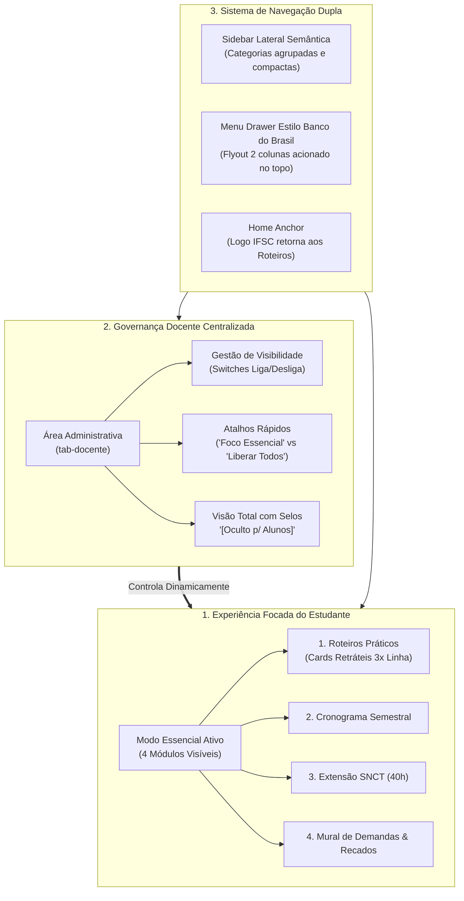

# Padrões de UX, Navegação e Gestão de Visibilidade para Dashboards Acadêmicos

> **Documento de Referência Arquitetural e de Replicabilidade**  
> **Unidade Curricular:** Programação para a Internet 2 (IFSC Câmpus Garopaba)  
> **Data de Homologação:** 05 de novembro de 2026  
> **Aplicabilidade:** Dashboards de UCs técnicas e superiores (ProgWeb 1, ProgWeb 2, PI 1, PI 2 e afins)  
> **Objetivo:** Registrar as inovações de usabilidade, layout fluido, menu gaveta multinível e gestão de visibilidade discente para avaliação e transposição entre plataformas.

---

## 1. Sumário Executivo das Funcionalidades

No ciclo de aprimoramentos de novembro de 2026, o dashboard da UC foi reestruturado para mitigar dois problemas clássicos em portais educacionais:
1. **Sobrecarga Cognitiva Discente:** O excesso de abas técnicas, rubricas e regulamentos dispersava a atenção dos estudantes do foco prático da semana.
2. **Subaproveitamento de Tela em Monitores Modernos:** Contêineres restritos a `1320px` comprimiam cards em colunas estreitas, enquanto deixavam grandes faixas vazias nas bordas em monitores Full HD (1080p) e widescreen.



---

## 2. Gestão Dinâmica de Visibilidade de Módulos (Discente vs. Docente)

### 2.1 Problema e Solução Pedagógica
Em ambientes acadêmicos, diferentes fases do semestre demandam diferentes níveis de exposição das informações. Expor o Sistema de Avaliação formal (rubricas somativas), o Raio-X institucional e a Ementa Oficial durante semanas de entrega prática de código polui a navegação do aluno.

A solução consiste em uma **camada de controle discente** acionada pelo professor através do painel docente.

### 2.2 Tabela de Módulos e Visibilidade Recomendada

| Módulo (`tabId`) | Ícone | Grupo Semântico | Estado Padrão Discente | Comportamento no Modo Essencial |
| :--- | :--- | :--- | :---: | :---: |
| `tab-roteiros` | `bi bi-code-square` | Laboratório & Aulas | **Visível (Fixo)** | **Página inicial padrão inalterável** |
| `tab-cronograma` | `bi bi-calendar-range-fill` | Laboratório & Aulas | **Visível** | Ativo (orientação das 20 aulas) |
| `tab-extensao` | `bi bi-megaphone-fill` | Extensão & Entregas | **Visível** | Ativo (8 frentes cirúrgicas da SNCT) |
| `tab-demandas` | `fa-solid fa-list-check` | Extensão & Entregas | **Visível** | Ativo (mural de prazos e recados) |
| `tab-raio-x` | `bi bi-speedometer2` | Visão Geral | *Oculto* | Disponível para liberação sob demanda |
| `tab-avaliacao` | `bi bi-calculator-fill` | Avaliação & PPC | *Oculto* | Liberado em períodos de fechamento |
| `tab-ementa` | `bi bi-book-half` | Avaliação & PPC | *Oculto* | Liberado no início/fim de semestre |
| `tab-sigaa` | `bi bi-mortarboard-fill` | Avaliação & PPC | *Oculto* | Consulta institucional sob demanda |
| `tab-docente` | `fa-solid fa-chalkboard-user` | Gestão Docente | *Restrito* | Acesso condicional à autenticação |

### 2.3 Especificação Técnica de Implementação

1. **Chave de Armazenamento:**
   ```javascript
   export const STORAGE_KEY_VISIBILIDADE_MODULOS = 'progweb2_visibilidade_modulos_estudantes';
   ```

2. **Contrato de Configuração:**
   ```javascript
   const configPadrao = {
     'tab-roteiros': true,
     'tab-cronograma': true,
     'tab-extensao': true,
     'tab-demandas': true,
     'tab-raio-x': false,
     'tab-avaliacao': false,
     'tab-ementa': false,
     'tab-sigaa': false
   };
   ```

3. **Mecanismo de Aplicação no DOM (`aplicarVisibilidadeModulos`):**
   - **Para Estudantes:** Oculta botões da sidebar que possuam `data-tab-id` desmarcado. Caso um grupo inteiro fique sem itens visíveis, o contêiner `.sidebar-group` é ocultado (`display: none`). No menu BB, as categorias correspondentes também são ocultadas.
   - **Para o Professor:** Todos os botões permanecem visíveis. Os botões desativados para alunos recebem dinamicamente um selo visual `<span class="badge bg-secondary-subtle text-secondary fs-label badge-oculto-estudante"><i class="bi bi-eye-slash"></i> Oculto</span>`.
   - **Segurança de Acesso e Redirecionamento:** Se um estudante tentar abrir uma aba oculta (via hash na URL ou histórico), a função `showTab` o redireciona suavemente para `tab-roteiros` exibindo um toast informativo.

---

## 3. Arquitetura do Layout Fluido e Aproveitamento de Espaço

### 3.1 Transição de `1320px` para `1600px` / `1680px`
Anteriormente, o layout utilizava o `max-width: 1320px` herdado do container clássico do Bootstrap. Com a introdução da barra lateral de 260px, a área útil para o conteúdo central caía para ~1020px, estrangulando os cards em colunas de menos de 300px.

Ajustes realizados no CSS:
```css
/* HEADER E MAIN CONTAINER EXPANDIDOS */
.header-container {
  max-width: 1600px;
  margin: 0 auto;
}

main.main-container {
  max-width: 1600px;
  margin: 1.5rem auto;
  padding: 0 1.5rem;
  width: 100%;
  flex: 1;
}

/* Telas Desktop Grandes e Ultrawide */
@media (min-width: 1400px) {
  .header-container,
  main.main-container {
    max-width: 1560px;
  }
}

@media (min-width: 1600px) {
  .header-container,
  main.main-container {
    max-width: 1680px;
  }
}

/* Sidebar Otimizada */
.app-sidebar {
  width: 260px;
  min-width: 245px;
  flex-shrink: 0;
  position: sticky;
  top: 1.5rem;
  z-index: 90;
}
```

### 3.2 Grid dos Roteiros (3 Colunas Confortáveis)
```css
.roteiros-grid {
  display: grid;
  grid-template-columns: repeat(auto-fill, minmax(310px, 1fr));
  gap: 1.25rem;
  align-items: stretch;
}

/* Mobile: Coluna única integral sem estouro */
@media (max-width: 640px) {
  .roteiros-grid {
    grid-template-columns: 1fr;
  }
}
```
* **Resultado:** Em resolução 1440px ou superior, cada card ocupa entre **380px e 430px** de largura horizontal. Títulos e metadados não sofrem quebras prematuras de linha e a área nobre do monitor é preenchida harmonicamente.

---

## 4. Cards de Roteiro Retráteis (Progressive Disclosure)

### 4.1 Anatomia do Card Resumido vs. Expandido
Para reduzir a altura visual e permitir visualizar rapidamente todos os 6 roteiros da disciplina sem rolagem excessiva, aplicou-se o princípio de *Progressive Disclosure*:

1. **Bloco Sempre Visível (Resumo Inicial):**
   - Ilustração de cabeçalho (`height: 140px`) com ribbon de foco;
   - Metadados do topo (badge de número do roteiro, status de conclusão e botão de estrela para destaque);
   - Título do roteiro (`.roteiro-title`);
   - Resumo descritivo (`.roteiro-card-desc`);
   - Botão sanfona de expansão: `.btn-toggle-roteiro-detalhes`.

2. **Bloco Retrátil (`.roteiro-card-detalhes`):**
   - Tags rápidas (`.card-quick-meta`);
   - Caixa de foco prático de laboratório (`.roteiro-focus-box`);
   - Painel dinâmico da SNCT (quando aplicável);
   - Botões de ação (Guia em PDF, Slides, Demo interativa).

```css
/* ESTILOS DO CONTEÚDO RETRÁTIL */
.roteiro-card-detalhes {
  display: none;
  flex-direction: column;
  gap: 0.65rem;
  margin-top: 0.65rem;
  padding-top: 0.65rem;
  border-top: 1px dashed var(--border-color);
  animation: fadeIn 0.25s ease-in-out;
}

.roteiro-card.expandido .roteiro-card-detalhes {
  display: flex;
}

.roteiro-card.expandido .btn-toggle-roteiro-detalhes .toggle-icon {
  transform: rotate(180deg);
}
```

3. **Controle Global:**
   - Botão `#btnToggleTodosCards` posicionado no cabeçalho da seção de roteiros, permitindo abrir ou recolher todos os 6 cards simultaneamente.
   - O card ativo como foco da turma (`.roteiro-highlight`) é mantido automaticamente com a classe `.expandido`.

---

## 5. Navegação Dupla: Sidebar Lateral + Drawer Estilo Banco do Brasil

### 5.1 Motivação da Estrutura
- **Sidebar Lateral Diária:** Focada em acesso rápido aos 4 módulos frequentes (1 clique, sem abrir sobreposições).
- **Mega-Menu Drawer (Estilo Banco do Brasil):** Oferece o mapa visual completo do site (site map) com categorias à esquerda e links profundos / atalhos detalhados à direita, ideal para orientações de início de aula, auditoria e navegação rápida por teclado (`ESC` fecha o modal).
- **Home Link:** A marca oficial do IFSC no cabeçalho superior funciona como âncora para retorno instantâneo à página inicial (`tab-roteiros`).

---

## 6. Guia de Replicação para Outros Dashboards (PI 1, PI 2, ProgWeb 1)

Para adotar esse padrão em outras unidades curriculares:

1. **Constantes e Dados:**
   - Declarar `STORAGE_KEY_VISIBILIDADE_MODULOS` em `constants.js` com a lista de módulos específicos daquela UC.
2. **Marcação Semântica da Sidebar:**
   - Adicionar atributos `data-tab-id="tab-nome"` em cada `<button class="sidebar-nav-btn">`.
   - Agrupar os botões em contêineres `<div class="sidebar-group">`.
3. **Card Administrativo na Área Docente:**
   - Incluir o bloco com o container `#containerSwitchesVisibilidadeModulos` e os botões de atalho rápido.
4. **CSS de Largura e Grid:**
   - Aplicar as regras de `.header-container` e `main.main-container` com `max-width: 1600px` / `1680px`.
   - Adicionar regras para `.roteiro-card-detalhes` e `.btn-toggle-roteiro-detalhes`.
5. **Orquestração JS:**
   - Reutilizar as funções `obterConfigVisibilidadeModulos()`, `salvarConfigVisibilidadeModulos()`, `aplicarVisibilidadeModulos()` e `renderizarPainelVisibilidadeModulosDocente()`.
   - Conectar as chamadas no ciclo de vida `DOMContentLoaded` e ao alternar o Modo Docente.

---
*Documento homologado e registrado no repositório oficial da Unidade Curricular.*
